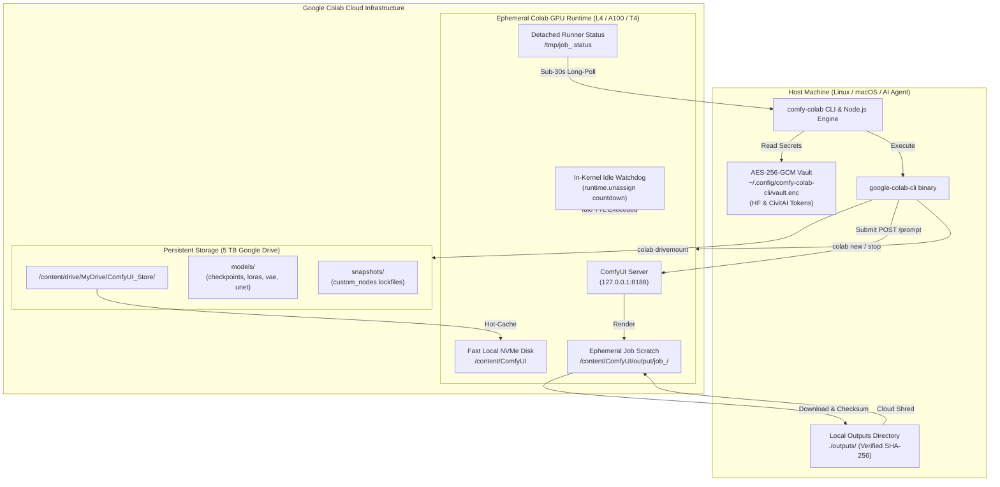

# comfy-colab-cli

> **Headless CLI and AI Agent Skill to spin up ComfyUI on Google Colab GPU runtimes, execute image and video workflows, manage persistent models on 5 TB Google Drive, and auto-terminate GPU sessions.**

[](https://github.com/sudo-krish/comfy-colab-cli/actions/workflows/ci.yml)
[](https://opensource.org/licenses/Apache-2.0)
[](https://nodejs.org/)
[](package.json)
[](test/)
[](tsconfig.json)

---

## Table of Contents

- [1. Executive Overview](#1-executive-overview)
- [2. System Architecture](#2-system-architecture)
- [3. Prerequisites & Environment](#3-prerequisites--environment)
- [4. Quickstart Guide (Human Walkthrough)](#4-quickstart-guide-human-walkthrough)
- [5. CLI Command Reference](#5-cli-command-reference)
- [6. Machine Interface: AI Agent Protocol (`--json`)](#6-machine-interface-ai-agent-protocol---json)
- [7. Hardware Escalation & GPU Matrix](#7-hardware-escalation--gpu-matrix)
- [8. Hybrid Drive-to-NVMe Model Architecture](#8-hybrid-drive-to-nvme-model-architecture)
- [9. Video Engine (Wan 2.1 & Hunyuan)](#9-video-engine-wan-21--hunyuan)
- [10. Local Testing & Verification Guide](#10-local-testing--verification-guide)
- [11. Troubleshooting & Cloud Lifecycle FAQ](#11-troubleshooting--cloud-lifecycle-faq)
- [12. Developer Guide & Quality Gates](#12-developer-guide--quality-gates)
- [13. License](#13-license)

---

## 1. Executive Overview

Running ComfyUI on ephemeral Google Colab VMs traditionally suffers from three critical bottlenecks:
1. **Fragile Web UI Automation**: Browser scrapers, reverse proxies, and Cloudflare tunnels break frequently and waste compute units while idling.
2. **Slow Drive FUSE Reads**: Reading 15 GB checkpoints (e.g., Flux.1 or SDXL) directly over mounted Google Drive FUSE (`/content/drive/MyDrive`) creates severe I/O stalls during model loading (45–90 seconds per model load).
3. **Execution Timeouts**: `colab exec` imposes a strict 30-second execution timeout, causing standard blocking runs on multi-minute diffusion or video workloads to fail.

`comfy-colab-cli` eliminates these problems through a **zero-tunnel, headless orchestrator**:
- **Direct CLI-to-CLI Kernel Piping**: Leverages Google's official `google-colab-cli` to pipe commands and API graphs directly into the VM kernel.
- **In-VM Long-Polling Pipeline**: Workflow submissions post to `http://127.0.0.1:8188/prompt`, returning immediately. A detached in-VM background runner polls `/history/{prompt_id}` and atomically writes progress to `/tmp/job_<id>.status`. The host CLI executes short in-VM long-poll calls (up to 24s per exec), completely bypassing the 30-second timeout.
- **Hybrid Storage & NVMe Hot-Caching**: Persistent checkpoints and LoRAs live on your 5 TB Google Drive (`/content/drive/MyDrive/ComfyUI_Store/`), while actively used models are hot-cached onto local NVMe (`/content/ComfyUI/models/`), reducing load times to ~2 seconds.
- **Sync-and-Shred Automation**: Outputs are downloaded directly to `./outputs/` with SHA-256 verification, after which remote cloud scratch files are shredded and VRAM is flushed (`POST /free`).
- **Zero Runaway Billing**: In-kernel Python watchdogs trigger `google.colab.runtime.unassign()` if an idle heartbeat expires (default: 20 minutes), ensuring you are never billed overnight if your machine disconnects.
- **Zero Production Dependencies**: Built exclusively with pure Node.js 22 built-ins (`node:crypto`, `node:child_process`, `node:fs`, `node:path`, `node:util`).

---

## 2. System Architecture



---

## 3. Prerequisites & Environment

| Requirement | Supported Version | Notes |
| :--- | :--- | :--- |
| **Operating System** | Linux (CachyOS, Arch, Ubuntu, Fedora) or macOS | Tested on Linux x86_64 and arm64 macOS |
| **Node.js** | `>= 20.0.0` (Recommended: Node 22 LTS) | Pure ESM; uses built-in Node standard modules |
| **Python Package Manager** | `uv` (`>= 0.4.0`) | Recommended for instant tool installation |
| **Google Colab CLI** | `google-colab-cli` (`colab`) | Install via `uv tool install google-colab-cli` |
| **Google Account** | Google AI Pro or Colab Pro subscription | Provides terminal access & 5 TB Google Drive |

---

## 4. Quickstart Guide (Human Walkthrough)

### Step 1: Diagnose Environment
Run the doctor check to verify that Node, `uv`, `google-colab-cli`, OAuth authentication, and GPU compute quotas are ready:
```bash
comfy-colab doctor
```

### Step 2: Configure Authenticated Model Registries
Store your HuggingFace and CivitAI API tokens in the machine-bound `AES-256-GCM` encrypted vault (`chmod 600`):
```bash
comfy-colab auth --hf hf_yourTokenHere --civitai civit_yourKeyHere
```

### Step 3: Scaffold Persistent Google Drive Storage
Initialize the persistent folder tree on your Google Drive:
```bash
comfy-colab setup
```
*(Creates `/content/drive/MyDrive/ComfyUI_Store/models/` and injects `extra_model_paths.yaml`).*

### Step 4: Generate Your First Image (Flux.1 Dev)
Run an end-to-end headless job with NVMe hot-caching and automatic ephemeral VM termination:
```bash
comfy-colab run \
  --template flux \
  --prompt "a majestic cybernetic lion in neon savanna, photorealistic 8k, volumetric lighting" \
  --hot-cache flux1-dev.safetensors \
  --output ./outputs \
  --ephemeral
```
Your image is rendered on Colab, downloaded to `./outputs/`, verified via SHA-256, cloud outputs are wiped, and the Colab VM is shut down to prevent billing leaks.

---

## 5. CLI Command Reference

All commands support both human-friendly console output and strict `--json` envelope mode.

| Command | Subcommand / Options | Description | Example Usage |
| :--- | :--- | :--- | :--- |
| `doctor` | `[--json]` | Diagnose system dependencies, Colab OAuth state, and compute balance. | `comfy-colab doctor --json` |
| `auth` | `[--hf <tok>] [--civitai <key>] [--json]` | Manage encrypted credentials in `vault.enc`. | `comfy-colab auth --hf hf_xxx --json` |
| `setup` | `[--path <drive_path>] [--json]` | Scaffold Drive directory tree and write `extra_model_paths.yaml`. | `comfy-colab setup --json` |
| `up` | `[--gpu L4\|A100\|T4] [--ttl <min>] [--mount-drive] [--bootstrap] [--json]` | Spin up Colab VM, mount Drive, and inject idle watchdog. | `comfy-colab up --gpu L4 --ttl 20 --json` |
| `stop` | `[-s\|--session <name>] [--json]` | Terminate a running Colab session immediately. | `comfy-colab stop -s comfy-session --json` |
| `sessions` | `[--json]` | List active Colab VM sessions and their states. | `comfy-colab sessions --json` |
| `image` | `--prompt <text> [--model <ckpt>] [--lora <chain>] [--set <override>] [--count <n>] [--batch-file <file>] [--json]` | Generate images, chain multiple LoRAs, or execute batch seed sweeps. | `comfy-colab image --prompt "hero" --lora "style:0.8" --json` |
| `video` | `--prompt <text> [--init-image ] [--model <ckpt>] [--gpu L4\|A100] [--json]` | Generate video with Wan 2.1 / VHS (T2V & I2V) with VRAM hardware checks. | `comfy-colab video --prompt "drone shot" --gpu L4 --json` |
| `template` | `list \| show <name> [--json]` | Inspect built-in golden API workflows (`flux`, `sdxl`, `wan21`). | `comfy-colab template show flux --json` |
| `run` | `[--template <name>] [-w <file.json>] [--prompt <text>] [--set <override>] [--output <dir>] [--hot-cache <ckpt>] [--ephemeral] [--json]` | Unified end-to-end execution pipeline with hot-cache and auto-teardown. | `comfy-colab run --template flux --ephemeral --json` |
| `models` | `list [--type <dir>] \| pull <url> [--type <dir>] \| upload <path> [--type <dir>] [--json]` | Inventory Drive models, pull via `aria2c` directly to Drive, or upload local LoRAs. | `comfy-colab models list --type loras --json` |
| `snapshot` | `save [name] \| restore <file.json> [--json]` | Save or restore custom node lockfiles on Google Drive. | `comfy-colab snapshot save stable_v1 --json` |
| `update` | `[--target cli\|comfy\|all] [--json]` | Upgrade `google-colab-cli`, `comfy-cli`, or ComfyUI core. | `comfy-colab update --target all --json` |
| `skill` | `install [--target <dir>] [--json]` | Generate and install `SKILL.md` into AI agent workspaces. | `comfy-colab skill install --json` |

---

## 6. Machine Interface: AI Agent Protocol (`--json`)

`comfy-colab-cli` is built from the ground up for autonomous AI coding agents (Claude Code, Antigravity, Cursor, Cline).

### Guarantees
1. **Deterministic Exit Codes**: `0` on success; `1` on error.
2. **Token Efficiency**: Every command executed with `--json` outputs a compact payload under **150 tokens**.
3. **No Terminal Hijacking**: Interactive spinners, banners, and progress bars are strictly suppressed.

### Standard Success Schema
```json
{
  "ok": true,
  "command": "run",
  "data": {
    "prompt": "a cybernetic astronaut, 8k",
    "template": "flux",
    "outputDir": "./outputs",
    "ephemeral": true
  }
}
```

### Standard Error Schema
```json
{
  "ok": false,
  "command": "video",
  "error": {
    "code": "ERR_GPU_OOM",
    "message": "GPU 'T4' has insufficient VRAM for 14B video generation. Escalating to 'L4' (24 GB) or 'A100' is strongly recommended."
  }
}
```

### Installing the Agent Skill
To equip an agent workspace with the skill instructions:
```bash
comfy-colab skill install
```
This generates an exhaustive, production-grade `SKILL.md` in `.gemini/skills/comfy-colab/` (or your chosen agent workspace directory).

---

## 7. Hardware Escalation & GPU Matrix

Colab provides multiple GPU tiers. Using the wrong tier leads to Out-Of-Memory (OOM) crashes:

| Workflow / Architecture | Checkpoint Examples | Minimum GPU | Recommended GPU | Notes |
| :--- | :--- | :--- | :--- | :--- |
| **SD 1.5** | `v1-5-pruned-emaonly.safetensors` | `T4` (16 GB) | `T4` | Low compute unit consumption (~0.2 units/hr) |
| **SDXL Base** | `sd_xl_base_1.0.safetensors` | `T4` (16 GB) | `L4` (24 GB) | Faster step iterations on Ada Lovelace architecture |
| **Flux.1 Dev / Schnell** | `flux1-dev.safetensors` (12B/FP8) | `L4` (24 GB) | `L4` / `A100` | Requires high RAM and fast FP8 tensor cores |
| **Wan 2.1 Video (T2V / I2V)** | `wan2.1_t2v_14B_fp8.safetensors` | `L4` (24 GB) | `L4` / `A100` | **T4 will OOM.** CLI warns and auto-escalates |
| **HunyuanVideo / LTX-Video** | `hunyuan_video.safetensors` | `L4` (24 GB) | `A100` (40/80 GB) | Enable VRAM tiling & `--lowvram` |

---

## 8. Hybrid Drive-to-NVMe Model Architecture

```
/content/drive/MyDrive/ComfyUI_Store/      <-- Persistent (5 TB Google Drive)
├── models/
│   ├── checkpoints/                      <-- Base checkpoints (SDXL, Flux, Wan)
│   ├── loras/                            <-- Custom LoRAs and styles
│   ├── vae/                              <-- VAE weights (ae.safetensors)
│   ├── clip/                             <-- CLIP & T5 text encoders
│   ├── controlnet/                       <-- ControlNet models
│   └── unet/                             <-- Standalone UNET models
├── snapshots/                            <-- custom_nodes version lockfiles
└── workflows/                            <-- Reusable API JSON graphs
```

### Direct Cloud-to-Drive Pull (`models pull`)
Instead of downloading 20 GB models to your local machine and slowly uploading them, `comfy-colab models pull` executes directly on the remote Colab VM at 1–2 Gbps:
```bash
comfy-colab models pull \
  https://huggingface.co/black-forest-labs/FLUX.1-dev/resolve/main/flux1-dev.safetensors \
  --type checkpoints \
  --json
```

### NVMe Hot-Caching (`--hot-cache`)
Before executing a generation job, passing `--hot-cache <filename>` copies the model from the Google Drive mount directly to `/content/ComfyUI/models/checkpoints/` on local NVMe disk, completely eliminating FUSE read latency.

---

## 9. Video Engine (Wan 2.1 & Hunyuan)

`comfy-colab video` automates the generation of temporal video sequences:
- **Text-to-Video (T2V)**: Generates 81-frame sequences encoded to H.264 MP4 (`yuv420p`) via `VHS_VideoCombine`.
- **Image-to-Video (I2V)**: Uploads an initial keyframe (`--init-image ./frame.png`), injects `LoadImage` and `VAEEncode` nodes, and cleans up the input frame post-generation.
- **Hardware Verification**: Automatically tests GPU VRAM and warns against running on T4 runtimes.

Example Text-to-Video:
```bash
comfy-colab video \
  --prompt "cinematic flythrough of a futuristic neon cyber-city at dusk, 4k" \
  --gpu L4 \
  --json
```

---

## 10. Local Testing & Verification Guide

You can test `comfy-colab-cli` locally using three complementary approaches:

### Method 1: Run the Automated Test Suite (Offline & Mocked)

The project includes 78 unit and integration tests covering all modules without needing active GPU credits:

```bash
# Run Vitest with code coverage report
make test

# Run the full 8-stage industrial quality gate pipeline
make check-all
```

---

### Method 2: Test CLI Commands Locally (Offline)

Ensure the project is built:
```bash
make build
```

Run commands directly via `node ./dist/cli.js <command>` (or run `npm link` in the repository root to use `comfy-colab` globally).

#### 1. Environment Diagnostics & Health Check
Verifies local Node.js version, `uv`, `google-colab-cli` binary, Colab OAuth state, and compute balance:
```bash
# Human-readable report
node ./dist/cli.js doctor

# Machine-readable JSON envelope
node ./dist/cli.js doctor --json
```

#### 2. Encrypted Credential Vault
Manage HuggingFace and CivitAI API tokens (stored in `~/.config/comfy-colab-cli/vault.enc` via `AES-256-GCM`):
```bash
# Inspect current vault status
node ./dist/cli.js auth

# Configure tokens (stored securely with chmod 600)
node ./dist/cli.js auth --hf hf_testToken123 --civitai civit_testKey456 --json
```

#### 3. Golden API Workflow Templates
Inspect pre-packaged golden ComfyUI API graphs:
```bash
# List available templates (flux, sdxl, wan21)
node ./dist/cli.js template list --json

# View full API workflow schema for Flux.1 Dev
node ./dist/cli.js template show flux --json
```

#### 4. Image Workflow Builder & Multi-LoRA Chaining
Test parameter patching, multi-LoRA daisy chaining, and dot-notation overrides:
```bash
# Chaining two LoRAs with custom weights and step override
node ./dist/cli.js image \
  --prompt "cyberpunk warrior in rain" \
  --lora "anime_style.safetensors:0.8,detailer.safetensors:0.5" \
  --set "5.inputs.steps=30" \
  --json
```

#### 5. Video Hardware Escalation Check
Verify that the CLI catches low-VRAM GPUs and warns against OOM crashes:
```bash
# Test with T4 (triggers VRAM escalation warning)
node ./dist/cli.js video --prompt "drone shot over neon city" --gpu T4

# Test with L4 (recommended 24 GB VRAM)
node ./dist/cli.js video --prompt "drone shot over neon city" --gpu L4 --json
```

#### 6. Model & Storage Management
Preview remote Google Drive inventory and direct cloud-pull scripts:
```bash
# List checkpoints
node ./dist/cli.js models list --type checkpoints --json

# Test cloud-to-drive direct download task
node ./dist/cli.js models pull https://huggingface.co/model.safetensors --type checkpoints --json
```

#### 7. AI Agent Skill Installation
Install the upgraded `SKILL.md` into your local agent workspace:
```bash
node ./dist/cli.js skill install
```

---

### Method 3: Testing Live Execution on Google Colab (Requires Colab Pro)

If you have an active Google Colab Pro or Google AI Pro subscription, test an end-to-end cloud generation session:

1. **One-Time Google OAuth**:
   ```bash
   colab auth
   ```
2. **Verify Compute Units**:
   ```bash
   colab usage
   ```
3. **Execute an Ephemeral End-to-End Run**:
   ```bash
   node ./dist/cli.js run \
     --template flux \
     --prompt "a majestic cybernetic lion in neon savanna, 8k" \
     --hot-cache flux1-dev.safetensors \
     --output ./outputs \
     --ephemeral \
     --json
   ```
   *(Starts Colab session, mounts Drive, hot-caches model to NVMe, renders generation, downloads verified output to `./outputs/`, shreds remote files, and auto-terminates the VM).*

---

## 11. Troubleshooting & Cloud Lifecycle FAQ

### 1. `colab new` or `comfy-colab up` Appears "Stuck" at `Creating session...`

When executing `colab new` or `comfy-colab up`, you may see:
```text
[colab] Creating session 'comfy-session'...
```
and the command may pause for 45 to 90 seconds.

#### Why This Happens
1. **Container & Driver Provisioning**: Google Colab actually assigns an ephemeral Google Cloud container, attaches the requested accelerator (`L4`, `A100`, or `T4`), and provisions the GPU kernel. This cold-boot allocation naturally takes **45–90 seconds** on Google's cloud infrastructure.
2. **Synchronous HTTPS Connection**: The official `google-colab-cli` binary opens an HTTPS connection to `https://colab.research.google.com/tun/m/assign` and blocks synchronously until the VM is ready without printing terminal progress spinners.
3. **Regional GPU Capacity & Silent Retries**: If Google Cloud experiences peak demand in your assigned region, the backend may return `503 Service Unavailable`. By default, `colab` retries up to 3 times with exponential backoff (10s, 20s, 40s), which can cause it to wait silently for **over 3 to 4 minutes**.

#### How to Resolve It

- **Fail-Fast Mode (Disable Long Silent Retries)**:
  Set `COLAB_CLI_ASSIGN_RETRIES=0` to force `colab` to report capacity issues within ~60 seconds instead of waiting across multiple retries:
  ```bash
  COLAB_CLI_ASSIGN_RETRIES=0 comfy-colab up --gpu L4
  # or raw:
  COLAB_CLI_ASSIGN_RETRIES=0 colab new --session comfy-session --gpu L4
  ```

- **Switch Accelerator Tiers**:
  If Google Cloud's `L4` pool is momentarily saturated in your region, try provisioning an alternative GPU shape:
  ```bash
  # Try T4 (Standard 16 GB GPU)
  COLAB_CLI_ASSIGN_RETRIES=0 comfy-colab up --gpu T4

  # Or try A100 (High-Memory Compute)
  COLAB_CLI_ASSIGN_RETRIES=0 comfy-colab up --gpu A100
  ```

- **Verify Your Credentials via CPU**:
  To confirm that your Google OAuth, authentication scopes, and CLI binary are fully working, spin up a lightweight CPU session:
  ```bash
  COLAB_CLI_ASSIGN_RETRIES=0 colab new --session test-cpu
  colab sessions
  colab stop --session test-cpu
  ```
  *(CPU sessions typically assign in ~45 seconds).*

---

### 2. Do I Need to Create Sessions Separately with `colab new`?

**No.** `comfy-colab` is an autonomous orchestrator:
- **`comfy-colab run`**: Automatically inspects `colab sessions`. If an active session already exists, it re-uses it immediately with zero provisioning delay. If no session is running, it automatically provisions the session (`colab new`), mounts your Google Drive, scaffolds ComfyUI paths, and arms the idle watchdog.
- **`--ephemeral` Flag**: When `--ephemeral` is supplied, `run` completes the generation, downloads outputs to `./outputs/`, shreds remote cloud files, and terminates the Colab GPU VM so compute units are never wasted.
- **`--dry-run` Flag**: Pass `--dry-run` to any command (`run`, `up`, `stop`) to preview the exact execution plan without creating or modifying cloud resources.

---

### 3. Checking Compute Quota & Runaway Session Protection

- **View Active Balance**:
  ```bash
  colab usage
  ```
  Displays current compute units balance and active assignments count.

- **In-Kernel Idle Watchdog**:
  Every VM provisioned by `comfy-colab up` or `comfy-colab run` receives an autonomous background Python watchdog running inside the Colab kernel. If an idle heartbeat expires (default: 20 minutes), the watchdog automatically invokes:
  ```python
  from google.colab import runtime
  runtime.unassign()
  ```
  This guarantees your GPU VM terminates even if your local terminal is disconnected, your machine sleeps, or your network drops.

---

## 12. Developer Guide & Quality Gates

This repository enforces an **8-stage shift-left industrial quality pipeline** via `.makelib`:

```bash
# Initialize development environment and git hooks
make init

# Run all 8 quality gates (ESLint strict, TypeScript strict, McCabe <= 10, Vitest >= 80%, detect-secrets, audit)
make check-all

# Run Vitest test suite with V8 code coverage
make test

# Format codebase with Prettier
make format

# Build production distribution bundles (CJS and ESM dual build)
make build
```

### Git Branch Policy
Enforced via native Git pre-commit hooks:
`^(feat|feature|fix|patch|major|breaking|docs|chore|refactor|ci)/[a-z0-9._-]+$`

---

## 13. License

Apache License 2.0. See [LICENSE](LICENSE) for details.
